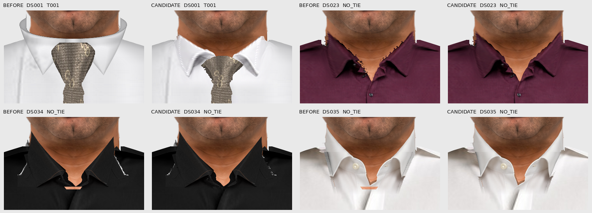

# Collar correction candidate

The source-based collar compositor is implemented and verified in Chromium and WebKit. The candidate entrypoint is `collar-candidate.html`. It is separate from the active application and awaits visual approval. This is a verified compositor repair pass; the remaining source-image defects listed below are still open.

## Corrected rendering

| Shirts and states | Change |
|---|---|
| DS001 / DS014, tied, outside suits | Replace the raised legacy white band with the same shirts' registered native collar components. Remove the amplified faint neckline fringe, use the selected registered native knot, and retain the original selected tie blade below row 529. |
| DS017 / DS034 / DS035 / DS036 / DS051, No Tie, outside suits | Close the disconnected 286-pixel skin slit with existing fabric from the same shirt at the same native coordinates. DS035 uses its original open-shirt body; the other four use their existing tied reconstruction base. |
| DS017 / DS034 / DS036 / DS051, No Tie, outside suits | Add a narrow same-shirt source underlay beneath supported internal outer-collar seams. These exact masks preserve existing silhouette support and remain more than six pixels from the avatar. |
| DS035, No Tie, outside suits | Trim the stepped outer-leaf fringe using alpha reductions. |
| DS023, No Tie, outside suits | Trim the full jagged inner-neck contour using alpha reductions, including the upper-right edge. |
| B03 with the repaired white tied collars | Preserve the inherited checkpoint wherever the actual B03 jacket, hands or cuffs own pixels. Applying the unrelated B02 ownership mask here caused holes during development; the final candidate removes that fault. |

These are runtime compositions of registered sources. No source PNG, garment photograph, avatar image, identity, score, styling rule, rejection rule or browser-storage schema was modified. The renderer still commits a complete detached frame atomically. Source-contract mismatches fail before a new visible frame is committed.

## Browser verification

Verified source commit: `b105df7873f825217ab120c22fae93174cf31d45`.

[Successful workflow run 44841862890](https://github.com/elgabrymd-arch/HEWRS-v1-16-1-candidate/actions/runs/44841862890) ran the actual unchanged `index.html` and then the actual `collar-candidate.html` in separate Chromium and WebKit jobs. Each browser comparison uses its own baseline.

| Result | Chromium | WebKit |
|---|---:|---:|
| Baseline native frames | 84 | 84 |
| Baseline checks passed / failed | 427 / 0 | 427 / 0 |
| Candidate native frames | 84 | 84 |
| Candidate checks passed / failed | 715 / 0 | 715 / 0 |
| Required full-frame controls | 38 | 38 |
| All outfits remaining fully pixel-identical | 50 | 50 |
| Outfits with intentional collar changes | 34 | 34 |
| Changed pixels outside `(320,350)–(680,590)` | 0 | 0 |
| Changed B03 jacket/hand/cuff-owned pixels | 0 | 0 |

All 84 selected identities and native 996×2748 dimensions were checked. Original contextual shirt/tie photographs stayed unchanged. Post-artifact checks also confirmed that every changed frame belongs to the intended repair states, and every other captured frame is identical. All 47 legacy tie states have a bound registered native source available to the new white-collar path; this source-mapping check is separate from the captured browser matrix.

Each browser also passed an isolated actual-UI sequence with one Generate action, twenty consecutive permanent clothing rejections, retained accepted rows, no return of earlier rejected clothing, tie-only rejection with preservation of other garments, Undo, and reload. The twenty clothing bans survived Undo and reload. Wear history and Favorites stayed unchanged. These checks used empty synthetic profiles, with no access to the owner's browser data and no external-service calls.

The complete captured matrix includes shirt-only and B03 states for all eight priority shirts; DS001/DS014 T017, T028 and T029 in those two modes; B02 No Tie/T001/T028/T029; the explicit B01 No Tie summer-dinner route; protected S05/S11 suits; and unaffected DS002, DS015 and DS026 controls. It does not include B02×T017. WebKit automation is not a physical iPhone test.

## Visual evidence

The comparison images contain actual browser canvas pixels. The earlier Chromium baseline captures used in the compact sheet match all 84 baseline RGBA hashes recorded by the final verification run.



- [All eight priority collars, before and after](evidence/collar_runtime_review/COLLARS_BEFORE_AFTER.png)
- [Chromium and WebKit candidate comparison](evidence/collar_runtime_review/BROWSER_COMPARISON.png)
- [Verification record, artifact hashes and all 168 candidate frame results](evidence/collar_runtime_review/VERIFICATION.json)

## Remaining visual defects

The rendering checks do not constitute complete visual approval:

- DS001/DS014 No Tie retains its existing jagged opening and diagonal fringe; those states remain unchanged controls.
- Several original exterior neck and shoulder cutouts remain rough. DS034/DS051 retain small bright edge scraps, and the unchanged DS035 tied source retains its gray side strip. Some outer seams lack a suitable opaque same-shirt donor at the same coordinate.
- The native white collar retains its source blur. Existing tie-knot stair steps and T017's bright texture transition remain in the registered tie sources.

The candidate does not claim these source-image limitations are fixed.

## Preservation and local use

The active application remains at commit `f114d7dbedab3430761a29d77328ae80ac0882e4`. The branch changes no `assets/` files and leaves `index.html`, `app.html`, `runtime/outfit-refill-preview.js`, `data/inputs.json`, `STARTUP_RESOURCES.json` and `STANDARD_RELEASE.json` byte-identical. The candidate adds a labelled entrypoint and its own fingerprinted runtime. The older diagnostic-only sheet remains historical; the browser evidence above is the final rendering evidence for this pass.

From this complete repository checkout:

```bash
python3 tools/build_collar_candidate.py --check
python3 -m http.server 8000
```

Open `http://127.0.0.1:8000/collar-candidate.html` for the candidate and `http://127.0.0.1:8000/index.html` for the unchanged application. The full repository assets are required; the HTML file alone is not a standalone app.

To reproduce the browser comparison after installing Pillow, NumPy and Playwright with the selected browser:

```bash
python3 tests/collar-candidate-browser.py --browser chromium --output evidence/collar_runtime_baseline --extra-controls
python3 tests/collar-candidate-browser.py --browser chromium --entrypoint collar-candidate.html --output evidence/collar_runtime_candidate --baseline-output evidence/collar_runtime_baseline --extra-controls --rejection-smoke
```

Use `webkit` in place of `chromium` for the second engine. The existing workflow performs both jobs and retains their full-resolution frames, changed-pixel masks and raw reports.
